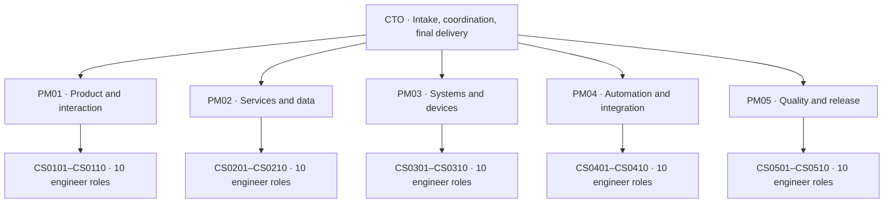

[English](README.md#start) | [简体中文](README.zh-CN.md#start)

<a id="start"></a>

# codex-cto-agent-team

A reusable Codex skill for a chief technology officer (CTO), five product managers, and fifty engineers.
The CTO gives work to the team and makes cross-team decisions. Product managers (PMs) divide tasks and review results. Engineers return outputs and evidence.
Use it across projects with private task records, explicit permissions, and one writer for each shared resource.

[Install](#install) · [Use](#use) · [Model routes](#model-routes) · [Private state](#private-state)

## Organization



The full roster has 56 roles, including the current CTO chat. A role definition does not make a chat.
A created chat, a READY reply, and active computation are different states. Chat count does not establish simultaneous computing capacity or permanent availability.
Use only roles that help the current task. Engineer specialties guide assignment and permit suitable work outside a title.

## Install

Use a Codex environment that supports local skills. The state helper requires Python 3.11 or later and uses only the standard library.
Chat creation, task messages, and monitoring require supported tools and account capacity. This skill does not add those capabilities.

1. Get this repository.
2. Make a copy of the complete `skills/cto-agent-team` folder in your personal skill directory.
3. Keep its `scripts`, `references`, `assets`, and `agents` folders.
4. Select `cto-agent-team` in Codex. If it is absent, restart Codex.

PowerShell example for a personal installation:

```powershell
git clone https://github.com/StochasticResult/codex-cto-agent-team.git
Set-Location codex-cto-agent-team
$skillSource = Join-Path (Get-Location) 'skills/cto-agent-team'
$skillTarget = Join-Path $env:USERPROFILE '.agents/skills/cto-agent-team'
if (Test-Path -LiteralPath $skillTarget) { throw 'The target exists. Review it before updating.' }
New-Item -ItemType Directory -Path (Split-Path -Parent $skillTarget) -Force | Out-Null
Copy-Item -LiteralPath $skillSource -Destination $skillTarget -Recurse
```

For a project installation, use `.agents/skills/cto-agent-team` in that project.
See the [official skill documentation](https://learn.chatgpt.com/docs/build-skills).
Third-party skills are separate dependencies. Installing this repository does not install them or prove that any chat has read them.

## Use

Open a CTO chat in the target project. Select the skill or use `$cto-agent-team` in your request.
For a plan, use:

> Use $cto-agent-team to plan the work for `<GOAL>`. Give the task owners and acceptance criteria. Do not make chats.

For a full organization of independent chats, use:

> Use $cto-agent-team for `<PROJECT>`. Use the current chat as CTO. Make five PM chats and ten engineer chats per PM.
> Use suitable existing chats. I permit creation of missing chats. I permit CTO-to-PM and PM-to-engineer task messages for this project.
> Keep private state in `<PRIVATE_STATE_DIR>`. Use the available tools and account capacity. Give actual creation and READY results.

Replace the placeholders before use. Skill selection alone does not authorize chat creation or task messages.
For a general request to use agents, follow existing authorization and tool support, or prepare a plan.
For independent chats, discover the current tool schema and make sure that the project is correct with `list_projects` before creation.
Examine unknown creation results before another attempt. Reuse real chat identifiers from supported tools.

Each task must identify its target, permissions, outputs, acceptance criteria, and writable resources.
Organizational delegation does not grant permission for every device, publication, external message, or purchase.
Read the target project's `AGENTS.md`. Make sure that the device identity, connection, and task permission are correct.

PMs collect engineer results with `wait_threads`. The CTO collects PM results the same way.
A task message does not by itself authorize a reply to another chat.
See [workflow.md](skills/cto-agent-team/references/workflow.md) for complete handoffs and result collection.

## Model routes

Choose settings by task within the user's approved scope:

| Route | Work | Model | Reasoning |
| --- | --- | --- | --- |
| `coordination_research` | Routine PM coordination and research across sources | `gpt-6.1-sol` | `high` |
| `scoped_engineering` | Scoped fixes, UI implementation, visual checks, and computer actions with a clear target | `gpt-6.1-terra` | `high` |
| `extraction` | Simple extraction and routine summaries from supplied material | `gpt-6.1-terra` | `medium` |
| `complex_engineering` | Complex coding, architecture, permissions, transactions, critical review, and releases across systems | `gpt-6.1-sol` | `xhigh` |
| `mechanical_supervision` | Routine status checks, retry records, deduplication, and completion-candidate routing | `gpt-6-luna` | `low` |

Within approved escalation scope, conflicting constraints, critical decisions, complex state, and substantive acceptance failures can require Sol/xhigh.
For ambiguity in extraction, first use Terra/high. Complex analysis can require Sol/high or Sol/xhigh.
Other configurations require user approval. Do not silently change settings when capacity is unavailable.

Role-registration defaults are Sol/high for PMs and Terra/high for engineers. They do not establish any chat's actual settings.
For each authorized creation or continuation, pass `model` and `thinking` where supported. Record the request and tool outcome privately.
Tool acceptance does not independently verify the backend model. Apply new routes on the next authorized dispatch.
Do not interrupt active work or wake idle engineers merely to change settings.
Keep the CTO's current settings, speed, subscription, and budget intact. See [model-routing.md](skills/cto-agent-team/references/model-routing.md).

## Delivery and supervision

Give each independent request a unique task ID and an owning PM. Send a complete handoff and end the CTO turn promptly.
PMs continue implementation, review, and authorized delivery in their own chats. New requests preserve earlier open tasks.
Link changes and cancellations to the original task. Assign useful independent work in parallel within actual capacity.
After an item completes, examine its evidence. Then give the next ready item to a suitable engineer.
Record the reason for a necessary serial step.
Keep one writer for each shared file, device, desktop, or live operation.

Use a suitable agent for routine supervision with the approved Luna/low route.
Read back supported monitor settings or documented model inheritance. Keep that evidence.
A model name in a prompt does not set the monitor model. Report unsupported settings accurately.
Reuse existing supervision and saved cursors. Keep unchanged checks and ordinary retries quiet.
Do not add a high-cost CTO loop to watch the supervisor.

A completion candidate must match the task and result revision. It must include output and acceptance evidence.
The responsible PM retains substantive acceptance. The CTO handles final delivery and cross-team decisions.
Messages to another chat require explicit recipient and scope authorization.
Keep separate retry and notification keys. Reconcile uncertain sends before repeating them.
Remove completed duties from shared monitoring. Retire a one-time monitor only when no duties remain.
An ended turn does not schedule its own return. This repository contains no background scheduler.

## Task skills

- **Coding and review:** read and apply the actual [Ponytail core](https://github.com/DietrichGebert/ponytail), with `full` guidance by default.
  This applies to any role doing relevant work. Include it in applicable new or resumed agent handoffs.
  Reuse existing helpers and deliver the smallest complete change. Preserve required validation, security, accessibility, error handling, and data integrity.
- **Frontend work:** consider [Anthropic Frontend Design](https://github.com/anthropics/skills/tree/main/skills/frontend-design).
  Select it, [Emil](https://github.com/emilkowalski/skills), or both by task. There is no fixed Emil priority.
  User requirements and the existing design system govern. Read the selected content and relevant references. Record the choice privately.
  For new pages, both skills can help. Frontend Design emphasizes overall direction. Emil gives detailed component and interaction guidance.
- **Task workflows:** use applicable [Superpowers](https://github.com/obra/superpowers) modules, such as `systematic-debugging` and `verification-before-completion`.
  Read the actual module and relevant references. Verify its availability and compatibility in your environment.
  Existing authorization, project rules, model routes, and single-writer ownership govern its use.
  Do not import blanket approval gates, mandatory worktrees, extra agent trees, repeated full-suite checks, or per-reply skill loading.

Read a skill once per relevant context. Reuse valid reading evidence unless the source changes or another read is needed.
Mechanical monitoring does not require loading every skill on each tick.
Do not restart accepted UI or repeat passed checks merely because a skill preference changed.
Third-party benchmarks do not establish this team's measured token, time, or cost savings.
See [coding.md](skills/cto-agent-team/references/coding.md) and [ui-design.md](skills/cto-agent-team/references/ui-design.md).

## Capacity recovery

Retry only a confirmed failed or stopped turn caused by temporary model capacity, with unfinished authorized work remaining.
The CTO owns PM recovery and may name one authorized supervisor as its sole retry executor. PMs own engineer recovery.
Use the failed turn's verified model and thinking. New defaults and the supervisor's model do not replace those settings.
Do not retry active, completed, or cancelled work. Preserve accepted outputs and completed external actions.
For an unknown send or external result, examine actual state before another attempt.

Default delays after successive failures are 0, 2, 5, 10, and 15 minutes, then 15 minutes.
A longer provider retry-after takes precedence. Delayed recovery requires supported, authorized follow-up.
Credentials, account exhaustion, approval requests, intentional stops, and permanent errors require their applicable workflow.
See [recovery.md](skills/cto-agent-team/references/recovery.md).

## Private state

Keep chat IDs, host IDs, local paths, task records, runtime evidence, and notification state outside the public repository and installed skill.
Never store credentials in these records. Use references to secure credential storage when necessary.
Each PM owns its logical team records. The helper uses a shared `registry.json`, so the CTO must serialize writes.
The helper has no cross-process lock. It records roles, not per-task routes, live execution, or backend model verification.

After installation, choose a private directory:

```powershell
$teamStateDir = Join-Path $env:LOCALAPPDATA 'codex-cto-agent-team/my-team'
python "$skillTarget/scripts/team_state.py" init --state-dir "$teamStateDir"
python "$skillTarget/scripts/team_state.py" validate --state-dir "$teamStateDir"
```

Initialization creates 55 `planned` subordinate roles. It does not make chats. The CTO continues in the current chat.
Use `--pm-model`, `--engineer-model`, or `--effort` to override registration snapshots.
`--effort` applies to both role groups. Task dispatch settings belong in separate private task records.

After a creation tool returns a verified identity, record it:

```powershell
python "$skillTarget/scripts/team_state.py" register --state-dir "$teamStateDir" --role PM01 --thread-id "<THREAD_ID_FROM_TOOL>" --host-id "<HOST_ID_FROM_TOOL>" --status created
```

The placeholders cannot be registered as real identifiers. Use the returned UUID and host ID.
After a real READY reply, repeat registration with the same identity and `--status ready`.
To require all 55 subordinate roles to be ready, use:

```powershell
python "$skillTarget/scripts/team_state.py" validate --state-dir "$teamStateDir" --require-ready
```

Ordinary validation permits uncreated roles. Existing private snapshots retain their original settings.
`validate` does not migrate them. Repeated `init` rejects an incompatible configuration instead of overwriting it.
If repeating initialization of an older all-xhigh snapshot, supply its original overrides, including `--effort xhigh`.
See [state.md](skills/cto-agent-team/references/state.md).

## Writing and review limits

Use the official ASD-STE100 writing rules and dictionary for applicable English task instructions, handoffs, and questions.
The reference is [Issue 9](https://www.asd-ste100.org/assets/files/ASD-STE100_ISSUE9.pdf).
Keep technical terms and literal commands consistent. Short sentences alone do not establish compliance.
Distinguish drafts, checked text, and verified compliance, with actual review evidence and gaps.
Chinese summaries carry no claim of compliance with an English standard.
The standard and its dictionary are not bundled. See [handoffs.md](skills/cto-agent-team/references/handoffs.md).

## Files and references

| File | Purpose |
| --- | --- |
| [SKILL.md](skills/cto-agent-team/SKILL.md) | Entry point and workflow selection |
| [workflow.md](skills/cto-agent-team/references/workflow.md) | Handoffs, scheduling, acceptance, and notifications |
| [model-routing.md](skills/cto-agent-team/references/model-routing.md) | Task settings, escalation scope, and supervision |
| [coding.md](skills/cto-agent-team/references/coding.md) | Ponytail and workflow boundaries |
| [ui-design.md](skills/cto-agent-team/references/ui-design.md) | UI skill selection and evidence |
| [recovery.md](skills/cto-agent-team/references/recovery.md) | Capacity failures, retries, and deduplication |
| [state.md](skills/cto-agent-team/references/state.md) | Private records and helper commands |
| [roster.json](skills/cto-agent-team/assets/roster.json) | Five teams, fifty engineer roles, and registration defaults |
| [team_state.py](skills/cto-agent-team/scripts/team_state.py) | Offline registration helper |
| [openai.yaml](skills/cto-agent-team/agents/openai.yaml) | Skill interface metadata |

This repository uses an English root README and explicit language links.
See GitHub's [README documentation](https://docs.github.com/en/repositories/managing-your-repositorys-settings-and-features/customizing-your-repository/about-readmes)
and [topics documentation](https://docs.github.com/en/repositories/managing-your-repositorys-settings-and-features/customizing-your-repository/classifying-your-repository-with-topics).
These documents do not establish automatic README selection by visitor language. Use the language links at the top.
