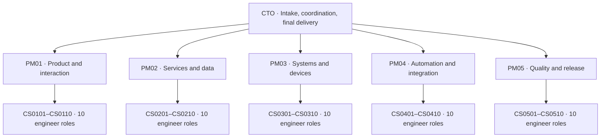

[English](README.md#start) | [简体中文](README.zh-CN.md#start)

<a id="start"></a>

# codex-cto-agent-team

[](https://github.com/StochasticResult/codex-cto-agent-team/actions/workflows/tests.yml)
[](https://github.com/StochasticResult/codex-cto-agent-team/releases)
[](LICENSE)
[](https://www.python.org/downloads/)

A reusable CTO team skill with Codex and Google Antigravity integration, host capability guidance, five product managers, and fifty engineers.
The CTO gives work to the team and makes cross-team decisions. Product managers (PMs) divide tasks and review results. Engineers return outputs and evidence.
Use it across projects with private task records, explicit permissions, advisory resource leases, and one writer for each shared resource.

[Install](#install) · [Reproducible demo](#reproducible-demo) · [Use](#use) · [Host compatibility and limits](#host-compatibility-and-limits) · [Adoption and maintenance evidence](#adoption-and-maintenance-evidence) · [Model routes](#model-routes) · [Private state](#private-state) · [License](#license)

## Organization



The full roster has 56 roles, including the current CTO chat. A role definition does not make a chat.
A created chat, a READY reply, and active computation are different states. Chat count does not establish simultaneous computing capacity or permanent availability.
Use only roles that help the current task. Engineer specialties guide assignment and permit suitable work outside a title.

## Install

Use a host that can load the skill or accept its instructions manually. The local helpers require Python 3.11 or later and only the standard library.
The installation commands below are for Codex. See the [host matrix](skills/cto-agent-team/references/host-adapters.md) for Claude Code, Cursor, and generic/cloud boundaries.
Those integrations have documented guidance, not live client validation or universal native adapters.
Chat creation, task messages, and monitoring require supported tools and account capacity. This skill does not add those capabilities.

1. Get this repository.
2. Make a copy of the complete `skills/cto-agent-team` folder in your personal skill directory.
3. Keep its `scripts`, `references`, `assets`, and `agents` folders.
4. Select `cto-agent-team` in Codex. If it is absent, restart Codex.

PowerShell example for a personal installation:

```powershell
git clone https://github.com/StochasticResult/codex-cto-agent-team.git
Set-Location codex-cto-agent-team
$skillSource = Join-Path (Get-Location) 'skills/cto-agent-team'
$skillTarget = Join-Path $env:USERPROFILE '.agents/skills/cto-agent-team'
if (Test-Path -LiteralPath $skillTarget) { throw 'The target exists. Review it before updating.' }
New-Item -ItemType Directory -Path (Split-Path -Parent $skillTarget) -Force | Out-Null
Copy-Item -LiteralPath $skillSource -Destination $skillTarget -Recurse
```

For a project installation, use `.agents/skills/cto-agent-team` in that project.
To share a single skill installation across both Codex and Google Antigravity, register your personal skill directory (`~/.codex/skills` or `~/.agents/skills`) in `~/.gemini/config/skills.json` under `entries`; see [antigravity-workflow.md](skills/cto-agent-team/references/antigravity-workflow.md).
See the [official skill documentation](https://learn.chatgpt.com/docs/build-skills).
Third-party skills are separate dependencies. Installing this repository does not install them or prove that any chat has read them.

## Reproducible demo

Run the offline end-to-end walkthrough in [examples/end_to_end_demo/run_demo.py](examples/end_to_end_demo/run_demo.py) using only Python 3.11+ standard library modules (no API keys, network access, or live host threads required):

```sh
python examples/end_to_end_demo/run_demo.py --verify
```

The demo runs inside a temporary private directory outside the repository and executes all five stages of a real task lifecycle (`CTO Intake -> PM02 Dispatch -> CS0201 Lease/Patch/Test -> PM02 SHA-256 Acceptance -> CTO Delivery`) while keeping capability layers strictly separated:

- **Executed deterministically by bundled scripts:** `team_state.py` (`init`, `register`, `validate`), `model_route.py` (`demo_routing_input.json`), `agent_guard.py` (`acquire`, competing writer `CS0202` blocked with exit code `2`, `run` watchdog running `unittest`, and `release`), atomic JSON event creation, SHA-256 digest checks, and `shared/STATUS.md` output.
- **Simulated for offline replay:** CTO / PM02 / CS0201 narrative handoff prose, deterministic synthetic `uuid5` thread IDs, and fixture catalog inputs (`dispatch_ready: false`).
- **Provided by a host runtime in live use:** Creating actual sub-sessions or subagents (`create_thread`, `invoke_subagent`), LLM inference, account quotas, browser UI verification, and completion wakeups.

See [examples/end_to_end_demo/README.md](examples/end_to_end_demo/README.md) for the complete stage diagram and sample output.

## Use

Open a CTO chat in the target project. Select the skill or use `$cto-agent-team` in your request.
For a plan, use:

> Use $cto-agent-team to plan the work for `<GOAL>`. Give the task owners and acceptance criteria. Do not make chats.

For a full organization of independent chats, use:

> Use $cto-agent-team for `<PROJECT>`. Use the current chat as CTO. Make five PM chats and ten engineer chats per PM.
> Use suitable existing chats. I permit creation of missing chats. I permit CTO-to-PM and PM-to-engineer task messages for this project.
> Keep private state in `<PRIVATE_STATE_DIR>`. Use the available tools and account capacity. Give actual creation and READY results.

Replace the placeholders before use. Skill selection alone does not authorize chat creation or task messages.
For a general request to use agents, follow existing authorization and tool support, or prepare a plan.
For independent chats, discover the current host tools and verify the target project before authorized creation.
[Host adapters](skills/cto-agent-team/references/host-adapters.md#execution-operations) contain specific tool names and parameter boundaries.
Examine unknown creation results before another attempt. Reuse real chat identifiers from supported tools.

Each task must identify its target, permissions, outputs, acceptance criteria, and writable resources.
Organizational delegation does not grant permission for every device, publication, external message, or purchase.
Read the target project's `AGENTS.md`. Make sure that the device identity, connection, and task permission are correct.

PMs read engineer results in shared private events. One designated clerk writes the shared summary.
The CTO reads that summary and necessary exact source references. Canonical tasks remain authoritative.
Use messages only for necessary authorized dispatch, continuation, or recovery, with task and document pointers.
Active recipients read at safe boundaries. Do not send routine progress or result relay messages.
See [workflow.md](skills/cto-agent-team/references/workflow.md) for complete handoffs and result collection.

## Model routes

Separate task requirements, host capabilities, model evidence, user policy, native parameters, and actual execution.
The following table is the explicit `compatibility-6.1` profile. It is not a default for every host or an availability claim:

| Route | Work | Model | Reasoning |
| --- | --- | --- | --- |
| `coordination_research` | Routine PM coordination and research across sources | `gpt-6.1-sol` | `high` |
| `scoped_engineering` | Scoped fixes, UI implementation, visual checks, and computer actions with a clear target | `gpt-6.1-terra` | `high` |
| `extraction` | Simple extraction and routine summaries from supplied material | `gpt-6.1-terra` | `medium` |
| `complex_engineering` | Complex coding, architecture, permissions, transactions, critical review, and releases across systems | `gpt-6.1-sol` | `xhigh` |
| `mechanical_supervision` | Routine status checks, retry records, deduplication, and completion-candidate routing | `gpt-6-luna` | `low` |

Within approved escalation scope, conflicting constraints, critical decisions, complex state, and substantive acceptance failures can require Sol/xhigh.
For ambiguity in extraction, first use Terra/high. Complex analysis can require Sol/high or Sol/xhigh.
User policy can authorize automatic routing and evidenced new candidates within existing resources. Respect explicit pins and hard budgets.
A new name alone does not require repeated approval within that authority. Capacity failure never authorizes silent substitution.

Role-registration defaults are Sol/high for PMs and Terra/high for engineers. They do not establish any chat's actual settings.
For each authorized dispatch, pass the exact supported native parameters. Record the request and tool outcome privately.
Tool acceptance does not independently verify the backend model. Apply new routes on the next authorized dispatch.
Do not interrupt active work or wake idle engineers merely to change settings.
Keep the CTO's current settings, speed, subscription, and budget intact. See [model-routing.md](skills/cto-agent-team/references/model-routing.md).

The standard-library [selector](skills/cto-agent-team/scripts/model_route.py) evaluates configurable evidence and returns a payload without sending it.
Try the credential-free fixture from the installed skill directory:

```sh
python scripts/model_route.py assets/routing.example.json --now 2030-01-02T00:00:00Z
```

The result is explicitly a fixture, with `dispatch_ready: false`. For actual work, replace synthetic evidence and use the current time.
Use the [seven-part schema](skills/cto-agent-team/assets/routing.schema.json), private policy/catalog inputs, and an explicit profile.
`--escalate-from` requires substantive failure and prior outcome evidence, and permits at most two quality upgrades.
`--retry-from` preserves the verified original native request and quality history, even when the normal catalog is stale.
A pin, unknown capability, unsupported parameter, or unsatisfied budget blocks selection. Unknown costs do not establish savings.
Different vendor effort/speed parameters are not synonyms. See the [selector guide](skills/cto-agent-team/references/model-routing.md#local-selector).
Documentation, account availability, permission, fixture/configuration, request acceptance, and actual execution are separate evidence levels.


## Delivery and supervision

Give each independent request a unique task ID and an owning PM. Send a complete handoff and end the CTO turn promptly.
PMs continue implementation, review, and authorized delivery. Shared events retain results and next actions. New requests preserve earlier open tasks.
Link changes and cancellations to the original task. Assign useful independent work in parallel within actual capacity.
After an item completes, examine its evidence. Then give the next ready item to a suitable engineer.
Record the reason for a necessary serial step.
Keep one writer for each shared file, device, desktop, or live operation.

Use a suitable agent for routine supervision through its authorized route. The compatibility profile retains Luna/low.
Read back supported monitor settings or documented model inheritance. Keep that evidence.
A model name in a prompt does not set the monitor model. Report unsupported settings accurately.
Reuse existing supervision and saved cursors. Keep unchanged checks and ordinary retries quiet.
Do not add a high-cost CTO loop to watch the supervisor.

A completion candidate must match the task and result revision. It must include output and acceptance evidence.
The responsible PM retains substantive acceptance. The CTO handles final delivery and cross-team decisions.
Follow the [shared document contract](skills/cto-agent-team/references/shared-handoffs.md).
Publish complete events atomically. Keep published events immutable and link corrections.
Persist consumed event identities and source revisions. Keep publication, acceptance, dispatch, and actual user delivery receipts separate.
A preview, active PM, or copied file does not establish actual engineering execution or delivery.
Host schedules are configurable capabilities. Reuse existing supervisors and summary readers without adding permanent-agent or scheduling promises.
Necessary wakeups still require explicit recipient and scope authorization.
Keep separate retry and notification keys. Reconcile uncertain sends before repeating them.
Remove completed duties from shared monitoring. Retire a one-time monitor only when no duties remain.
An ended turn does not schedule its own return. This repository contains no background scheduler.

## Task skills

Before relevant planning, implementation, or review, find suitable skills in the available catalog.
Select user- or project-specific guidance before generic preferences. Read actual selected content and relevant references.
Keep explicit style, constraints, and observable acceptance in handoffs. Record the few decisions that changed the output.

- **Coding and review:** read and apply the actual [Ponytail core](https://github.com/DietrichGebert/ponytail), with `full` guidance by default.
  This applies to any role doing relevant work. Include it in applicable new or resumed agent handoffs.
  Reuse existing helpers and deliver the smallest complete change. Preserve required validation, security, accessibility, error handling, and data integrity.
- **Frontend work:** consider [Anthropic Frontend Design](https://github.com/anthropics/skills/tree/main/skills/frontend-design), [Emil](https://github.com/emilkowalski/skills), and [Unslop](https://github.com/heydamir/unslop) (by Damir Sokolovsky `@heydamir`, CC BY 4.0).
  Select one or a combination by task rather than using a fixed single-skill priority: Frontend Design emphasizes greenfield direction, Emil governs component and interaction polish, and `unslop` audits and removes vibecoded/AI-generated tells through nine ordered redline passes.
  User requirements, multi-language layout geometry, and the existing design system govern. Read the selected content and relevant references, and record the choice privately.
- **Google Antigravity and multi-agent guardrails:** follow [antigravity-workflow.md](skills/cto-agent-team/references/antigravity-workflow.md) for `invoke_subagent` / `schedule` mapping, `BROWSER_HOST_FACTS` UI verification, concise milestone reporting, fast stop-loss, subagent model floors, `scripts/agent_guard.py` advisory resource leases and process/SSH watchdogs, multi-CTO peer queues, and production freeze windows.
- **Task workflows:** use applicable [Superpowers](https://github.com/obra/superpowers) modules, such as `systematic-debugging` and `verification-before-completion`.
  Read the actual module and relevant references. Verify its availability and compatibility in your environment.
  Existing authorization, project rules, model routes, and single-writer ownership govern its use.
  Do not import blanket approval gates, mandatory worktrees, extra agent trees, repeated full-suite checks, or per-reply skill loading.

Read a skill once per relevant context. Reuse valid reading evidence unless the source changes or another read is needed.
Mechanical monitoring does not require loading every skill on each tick.
Do not restart accepted UI or repeat passed checks merely because a skill preference changed.
Third-party benchmarks do not establish this team's measured token, time, or cost savings.
See [coding.md](skills/cto-agent-team/references/coding.md) and [ui-design.md](skills/cto-agent-team/references/ui-design.md).

Responsible owners compare the actual artifact with acceptance criteria. Skill names, reading evidence, and passing code tests alone do not establish visual or business acceptance.
Visual claims need relevant observed views tied to the artifact revision. Claims about published appearance need evidence from that served version.
Record missing observations. Use proportional checks, without a blanket browser gate, repeated full-site review, or new user approval flow.

Help people complete primary tasks on first use. Give defaults that work, clear entry points and states, and a way to correct errors.
Use the [usability baseline](skills/cto-agent-team/references/ui-design.md#usability-baseline) from handoff through actual artifact acceptance.
Keep details progressive and accessibility appropriate. Record observations without calling an agent walkthrough real user research or claiming universal usability.

## Optional research

A shared researcher is an optional extension. The core five teams and 55 subordinate registrations stay unchanged.
Start with project capabilities and prior results, then first-party documentation and relevant open-source code.
Keep at most three candidates and one recommendation, with source/version/license, uncertainty, tradeoffs, and a minimal reuse path.
The owning PM records adoption and implementation acceptance. Stop at the agreed boundary or when evidence answers the question.
Use a suitable existing role when worker creation is unavailable. Urgent recovery, small changes, and ready releases have no research gate.
See the [bounded report template](skills/cto-agent-team/references/research.md#bounded-report).

## Capacity recovery

Retry only a confirmed failed or stopped turn caused by temporary model capacity, with unfinished authorized work remaining.
The CTO owns PM recovery and may name one authorized supervisor as its sole retry executor. PMs own engineer recovery.
Use the failed turn's verified model, complete native settings, and quality history. New defaults and the supervisor's model do not replace those settings.
Do not retry active, completed, or cancelled work. Preserve accepted outputs and completed external actions.
For an unknown send or external result, examine actual state before another attempt.

Default delays after successive failures are 0, 2, 5, 10, and 15 minutes, then 15 minutes.
A longer provider retry-after takes precedence. Delayed recovery requires supported, authorized follow-up.
Credentials, account exhaustion, approval requests, intentional stops, and permanent errors require their applicable workflow.
See [recovery.md](skills/cto-agent-team/references/recovery.md).

## Private state

Keep chat IDs, host IDs, local paths, task records, runtime evidence, and notification state outside the public repository and installed skill.
Never store credentials in these records. Use references to secure credential storage when necessary.
Each PM owns its logical team records. The helper uses a shared `registry.json`, so the CTO must serialize writes.
The registration helper has no cross-process lock. It records roles, not per-task routes, live execution, or backend model verification.
It supports UUID worker identities. Other hosts can keep their real identities in separate private task records.
The routing selector is separate and does not rewrite old registration snapshots.

After installation, choose a private directory:

```powershell
$teamStateDir = Join-Path $env:LOCALAPPDATA 'codex-cto-agent-team/my-team'
python "$skillTarget/scripts/team_state.py" init --state-dir "$teamStateDir"
python "$skillTarget/scripts/team_state.py" validate --state-dir "$teamStateDir"
```

Initialization creates 55 `planned` subordinate roles. It does not make chats. The CTO continues in the current chat.
Use `--pm-model`, `--engineer-model`, or `--effort` to override registration snapshots.
`--effort` applies to both role groups. Task dispatch settings belong in separate private task records.

After a creation tool returns a verified identity, record it:

```powershell
python "$skillTarget/scripts/team_state.py" register --state-dir "$teamStateDir" --role PM01 --thread-id "<THREAD_ID_FROM_TOOL>" --host-id "<HOST_ID_FROM_TOOL>" --status created
```

The placeholders cannot be registered as real identifiers. Use the returned UUID and host ID.
After a real READY reply, repeat registration with the same identity and `--status ready`.
To require all 55 subordinate roles to be ready, use:

```powershell
python "$skillTarget/scripts/team_state.py" validate --state-dir "$teamStateDir" --require-ready
```

Ordinary validation permits uncreated roles. Existing private snapshots retain their original settings.
`validate` does not migrate them. Repeated `init` rejects an incompatible configuration instead of overwriting it.
If repeating initialization of an older all-xhigh snapshot, supply its original overrides, including `--effort xhigh`.
See [state.md](skills/cto-agent-team/references/state.md).

## Browser tool policy

Honor the user's browser/channel choice and discover actual tools, connections, tabs, locators, target URL, and profile identity.
Prefer extension browser APIs for browser work. A unified `cua` or Computer Use entry can expose those APIs.
The [configurable Chrome example](skills/cto-agent-team/references/host-adapters.md#browser-channels) does not require every user to install Chrome.
Use native control only for a verified necessary tool gap, keep the action minimal, and use the supported browser channel selected for the task again.
Existing authorization governs exceptions. Preserve shared ownership, user activity, and meeting holds.
Carry policy and evidence requirements through every handoff and model route, including Terra. Keep browser policy outside model-native parameters.
A specified signed-in UI needs actual target/profile and page/action/result evidence. HTTP, builds, markers, or synthetic pages cannot replace it.
These are guidance and task-context examples, not a deployed browser adapter or a report of real browser execution.

## Work records

For requested records, use [work-recording.md](skills/cto-agent-team/references/work-recording.md).
Configure included and excluded projects privately. Formal team, skill, or game-business work can be included when the user's scope permits it.
Use durable source/project/task identity and revision evidence. Keep stages, reopened work, partial scope, and unknown time accurate.
Preserve manual changes and deletion tombstones. Use bounded incremental batches through the actual authorized target contract.
Record a successful cursor change only after commit and readback validation. Failed or unavailable coverage stays pending without losing history.
This guidance adds no collector, scheduler, personal timeline backend, or automatic synchronization.

## Portable use and improvement

For another project or machine, follow [portable setup and resume](skills/cto-agent-team/references/state.md#portable-setup-and-resume).
Choose explicit paths and record dependency sources, versions, licenses, and compatibility limits.
Keep valid authorization. Establish missing credentials or device permission only when a protected operation needs them.
Copied state grants neither. An isolated local directory test does not verify another device.

Use task-completion or recurring-failure events for [bounded improvements](skills/cto-agent-team/references/workflow.md#evidence-based-improvement).
Record the observation, evidence, owner, validation, decision, and rollback method privately.
Keep limited evidence under trial. Preserve newer notification evidence during recovery.
Unknown costs remain unknown. This repository does not include a supervisor-state patch tool or an optimization service.

For changed data or tool boundaries, use [consumer-specific contract evidence](skills/cto-agent-team/references/coding.md#consumer-contract-evidence).
For a long task's turning points, keep short [decision/resume checkpoints](skills/cto-agent-team/references/state.md#decision-and-resume-checkpoints).
These methods add no pstack installation, logging service, or model probe.

## Writing and review limits

Use the official ASD-STE100 writing rules and dictionary for applicable English task instructions, handoffs, and questions.
The reference is [Issue 9](https://www.asd-ste100.org/assets/files/ASD-STE100_ISSUE9.pdf).
Keep technical terms and literal commands consistent. Short sentences alone do not establish compliance.
Distinguish drafts, checked text, and verified compliance, with actual review evidence and gaps.
Chinese summaries carry no claim of compliance with an English standard.
The standard and its dictionary are not bundled. See [handoffs.md](skills/cto-agent-team/references/handoffs.md).

## Files and references

| File | Purpose |
| --- | --- |
| [SKILL.md](skills/cto-agent-team/SKILL.md) | Entry point and workflow selection |
| [workflow.md](skills/cto-agent-team/references/workflow.md) | Handoffs, scheduling, acceptance, and notifications |
| [model-routing.md](skills/cto-agent-team/references/model-routing.md) | Task settings, escalation scope, and supervision |
| [host-adapters.md](skills/cto-agent-team/references/host-adapters.md) | Host matrix, installation, native parameters, and evidence levels |
| [antigravity-workflow.md](skills/cto-agent-team/references/antigravity-workflow.md) | Google Antigravity dual-runtime setup, subagent mapping, cadence, leases, peer queues, and freeze windows |
| [research.md](skills/cto-agent-team/references/research.md) | Optional research and adoption |
| [model_route.py](skills/cto-agent-team/scripts/model_route.py) | Local configurable selector, quality escalation, and exact retry payload |
| [agent_guard.py](skills/cto-agent-team/scripts/agent_guard.py) | Private advisory resource leases and bounded process/SSH watchdog |
| [coding.md](skills/cto-agent-team/references/coding.md) | Ponytail and workflow boundaries |
| [ui-design.md](skills/cto-agent-team/references/ui-design.md) | UI skill selection and evidence |
| [recovery.md](skills/cto-agent-team/references/recovery.md) | Capacity failures, retries, and deduplication |
| [state.md](skills/cto-agent-team/references/state.md) | Private records and helper commands |
| [roster.json](skills/cto-agent-team/assets/roster.json) | Five teams, fifty engineer roles, and registration defaults |
| [team_state.py](skills/cto-agent-team/scripts/team_state.py) | Offline registration helper |
| [openai.yaml](skills/cto-agent-team/agents/openai.yaml) | Skill interface metadata |
| [run_demo.py](examples/end_to_end_demo/run_demo.py) | Reproducible five-stage offline workflow demonstration |
| [validate_repo.py](scripts/validate_repo.py) | Repository integrity, link, package, and changelog verifier |
| [CHANGELOG.md](CHANGELOG.md) | Release history and upgrade scope |
| [CONTRIBUTING.md](CONTRIBUTING.md) | Contribution workflow, verification commands, and PR rules |
| [SECURITY.md](SECURITY.md) | Supported versions and private vulnerability reporting |
| [LICENSE](LICENSE) | MIT license text |

## Host compatibility and limits

Do not confuse a documented host adapter guide with live end-to-end client certification. See [host-adapters.md](skills/cto-agent-team/references/host-adapters.md) for full details.

| Host | Status in this repository | Prerequisites & hard constraints |
| --- | --- | --- |
| **OpenAI Codex (CLI / Desktop)** | Empirically used by maintainer; local CLI scripts tested in CI | Desktop thread tools (`create_thread`, `send_message_to_thread`, `wait_threads`) depend on the desktop host environment and account quota; role configuration can override per-dispatch model flags. |
| **Google Antigravity** | Operational dual-runtime workflow via [antigravity-workflow.md](skills/cto-agent-team/references/antigravity-workflow.md) and `agent_guard.py` | Requires shared `~/.gemini/config/skills.json` registration or `.agents/skills`; parallel writers must pair `Workspace: "share"`/`"branch"` with `agent_guard.py` advisory leases and `BROWSER_HOST_FACTS` corroboration. |
| **Claude Code / Cursor / Generic** | Documented compatibility guidance only (no live client CI) | Custom model-key schemas (`thinking`, bracket syntax, `effort`) and subagent APIs are not auto-translated by `model_route.py`; falls back to manual context loading and sequential role execution when parallel subagents are absent. |

Key operational limits across every host:
- **Permissions:** Helpers inherit existing shell, filesystem, and browser authorizations; `--state-dir` and `--lock-dir` are enforced outside public repositories and skill directories.
- **Session creation & parallelism:** Initializing `roster.json` (`planned`) allocates zero chats; true concurrency requires host subagent/thread creation tools, account capacity, and single-writer locks (`agent_guard.py`).

## Adoption and maintenance evidence

This repository started on `2026-10-28` and is actively developed for multi-service engineering and dual-runtime (`Codex` + `Google Antigravity`) agent workflows. Rather than publishing unverified benchmarks or fabricated testimonials, the repository tracks concrete operational failure modes resolved in its commit history and automated test suite:

- **Eliminating chat-relay noise & partial handoffs:** Atomic JSON event files (`shared/events/<ROLE>/<TASK-ID>/`) plus one clerk summary (`shared/STATUS.md`) replaced ad-hoc status relays (`beb89b5`).
- **Preventing cross-task context leakage:** Isolated per-task execution contexts (`6194560`, `ff3b1cb`) and durable SHA-256 artifact pointers (`shared-handoffs.md`).
- **Blocking parallel write collisions & hung commands:** `agent_guard.py` provides portable advisory leases (`RESOURCE_LOCKED` exit code `2`) and process-tree/SSH watchdogs (`1ce9ccf`), covered by regression unit tests under `tests/`.
- **Preventing false completion & visual-acceptance drift:** Deliverable acceptance separates unit tests, artifact SHA-256 hashes, and host-verified `BROWSER_HOST_FACTS` observations before CTO delivery.

Real-world feedback, host compatibility findings, and external project reports are welcome through [Bug reports](.github/ISSUE_TEMPLATE/bug_report.yml), [Use-case / compatibility feedback](.github/ISSUE_TEMPLATE/use_case_feedback.yml), and pull requests; resolved changes are tracked in [CHANGELOG.md](CHANGELOG.md).

## License

Licensed under the [MIT License](LICENSE). Third-party external skills and specifications linked in documentation (such as `Ponytail`, `Superpowers`, `Anthropic Frontend Design`, `emil-design-eng`, `unslop`, and `ASD-STE100`) keep their respective upstream licenses and are not redistributed inside this repository.

This repository uses an English root README and explicit language links.
See GitHub's [README documentation](https://docs.github.com/en/repositories/managing-your-repositorys-settings-and-features/customizing-your-repository/about-readmes)
and [topics documentation](https://docs.github.com/en/repositories/managing-your-repositorys-settings-and-features/customizing-your-repository/classifying-your-repository-with-topics).
These documents do not establish automatic README selection by visitor language. Use the language links at the top.
