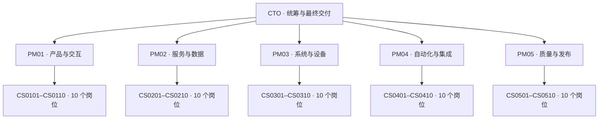

[English](README.md#start) | [简体中文](README.zh-CN.md#start)

<a id="start"></a>

# codex-cto-agent-team

把 CTO → 5 名产品经理 → 每队 10 名 CS 工程师的组织方式封装为可跨项目使用的 Codex skill。CTO 统筹目标和跨队依赖，PM 拆解与验收，工程师执行有明确范围的工单。



完整编制为 56 个角色，包含现有 CTO。岗位定义、实际聊天、READY 和正在计算的实例分别核实；会话数量不代表并发额度，也不保证永久在线。具体工单只启用需要的岗位。

| 岗位登记 | 默认模型 | 默认推理 |
| --- | --- | --- |
| PM01–PM05 | `gpt-6.1-sol` | `high` |
| CS 工程师 | `gpt-6.1-terra` | `high` |

实际派单按任务选择配置，用户可覆盖。岗位登记默认不代表所有现有聊天已经切换；请求被工具接受也不等于独立核实了后端模型。请求的配置不可用时报告限制，不静默更换。

## 任务模型路由

| 路由 | 适用任务 | 模型 | 推理 |
| --- | --- | --- | --- |
| `coordination_research` | PM 日常统筹、多来源研究 | `gpt-6.1-sol` | `high` |
| `scoped_engineering` | 范围明确修复、UI 实现、视觉检查、目标明确的电脑操作 | `gpt-6.1-terra` | `high` |
| `extraction` | 已给材料的简单结构化提取、常规摘要 | `gpt-6.1-terra` | `medium` |
| `complex_engineering` | 复杂编码、架构、事务、权限、关键审阅、跨系统发布 | `gpt-6.1-sol` | `xhigh` |
| `mechanical_supervision` | 机械状态检查、确定规则重试记账、去重、完成候选事件路由 | `gpt-6-luna` | `low` |

在用户批准的路由范围内升级：约束冲突、关键决策或高影响验收使用 Sol/xhigh；跨模块复杂状态或实质验收失败使用 Sol/xhigh。简单提取出现关键歧义时先使用 Terra/high，复杂分析使用 Sol/high 或 Sol/xhigh。范围外配置仍需用户同意。

新建或继续聊天时，按当前工具支持的参数显式传入 `model` 和 `thinking`，私下记录路由、原因、请求与工具结果。新策略从下一次授权派单生效；不为改设置中断在途工作、唤醒待命工程师或覆盖历史请求。已有关键发布沿用其记录的配置。CTO 当前设置、速度、订阅和预算不变，也不增加模型试验或付费基准作为上线门槛。完整说明见[模型路由](skills/cto-agent-team/references/model-routing.md)。

## 安装

需要支持本地 skills 的 Codex 环境；登记脚本需要 Python 3.11 或更新版本，仅使用标准库。独立聊天的创建与派单还取决于当前环境提供的工具和账号额度；安装 skill 不会增加这些权限或额度。

1. 获取本仓库，将 `skills/cto-agent-team` 整个文件夹复制到个人 skill 目录 `~/.agents/skills/cto-agent-team`，以便跨项目使用。项目内安装可放到目标仓库的 `.agents/skills/cto-agent-team`。
2. 保留文件夹内的 `scripts/`、`references/`、`assets/` 和 `agents/`。如果已经安装同名 skill，先检查现有内容再更新。
3. 在 Codex 的 skill 选择器中确认 `cto-agent-team` 可用；若尚未出现，重启 Codex。安装目录遵循 [官方 skill 文档](https://learn.chatgpt.com/docs/build-skills)。

PowerShell 安装示例：

```powershell
git clone https://github.com/StochasticResult/codex-cto-agent-team.git
Set-Location codex-cto-agent-team
$skillSource = Join-Path (Get-Location) 'skills/cto-agent-team'
$skillTarget = Join-Path $env:USERPROFILE '.agents/skills/cto-agent-team'
if (Test-Path -LiteralPath $skillTarget) { throw '目标已存在，请先检查再更新。' }
New-Item -ItemType Directory -Path (Split-Path -Parent $skillTarget) -Force | Out-Null
Copy-Item -LiteralPath $skillSource -Destination $skillTarget -Recurse
```

## 使用

先在目标项目中打开 CTO 聊天，选择 skill 或在提示中使用 `$cto-agent-team`。下面的独立聊天示例同时明确创建范围和内部转达授权；将尖括号中的内容替换为自己的项目和私有目录。

> 使用 $cto-agent-team，在 <目标项目> 建立 CTO → 5 名 PM → 每 PM 10 名 CS 的独立聊天组织。授权创建缺少的 PM 和 CS 聊天，并授权 CTO 向 PM、PM 向本队 CS 转达本任务范围内的工单。优先复用已核实的已有聊天，私有状态目录使用 <PRIVATE_STATE_DIR>。按实际工具和额度分批推进，返回真实创建及就绪结果。

Skill 自动匹配不等于允许创建 55 个独立聊天。仅需方案时可以说：

> 使用 $cto-agent-team，为 <业务目标> 规划团队分工和验收条件，本轮只输出规划。

仅泛化要求“使用 agents”时，按已获授权和现有能力使用 collaboration 子agent或先规划。用户明确选择独立聊天时采用独立聊天模式；先发现工具并读取当前 schema，创建前用 `list_projects` 核实目标项目。工具缺失就报告受限，不将岗位配置当成已创建会话。执行细节见 [工作流](skills/cto-agent-team/references/workflow.md)。

用户明确给出的组织级授权可覆盖其范围内的后续内部派单；具体工作仍受工单的目标项目、设备、可写资源及动作范围约束。同一文件、桌面或应用会话同一时刻只有一名写入负责人。PM 通过 `wait_threads` 读取工程师结果，CTO 同样读取 PM 结果；不要求下级主动向上级聊天发信。无工单时结束当前回合，后续复用已有会话。

## 快速接单、多需求推进与完成通知

CTO 聊天是持续接单入口。每条独立需求先建立唯一任务编号，记录目标、验收条件、主责 PM、依赖和资源归属，快速派发完整上下文，简短确认开始后结束 CTO 当前回合。PM 在自己的聊天中继续实现、验收和已授权的安装或发布，独立闭环；用户可随时继续向 CTO 提出新需求。

多项独立需求按实际额度并行推进，新需求保留旧任务。修改、补充或取消关联原任务并转达主责 PM，独立需求建立新工单。同一文件、设备、桌面或应用会话的冲突由 CTO 协调顺序或隔离；只有必要决定才简短询问用户。交接须包含现有授权、目标和文件位置、验收、证据要求及收尾负责人。

主聊天只做简短开始确认和完成通知；细节留在 PM 聊天，失败且需要用户动作时才打断。例如：

> 使用 $cto-agent-team，分别推进 <需求一> 和 <需求二>，保留每项任务的编号、状态和依赖。快速交接给对应 PM 后结束当前回合；完成时通知我，细节保留在 PM 聊天。沿用已有内部派单授权；若尚未授权创建独立聊天，先使用已核实且可用的组织。

用户要求完成通知时，使用当前可用且获授权的线程 heartbeat 或 automation 跟进，优先由合适的监督者承担机械检查，复用已有监测、保存 cursor，无变化保持安静。验收通过后，通知附结果链接或产物及必要局限，记录 `notified` 和证据。共享监测只移除已完成职责，所有职责结束后才停用一次性监测。监测能力不可用时如实说明；结束聊天本轮不会自动保证以后唤醒。聊天数量也不代表同时计算能力。

机械监督使用已批准的 Luna/low 路由；CTO 专注接单、派单、跨团队决定和最终交付，实际执行由合适工程师承担。须通过支持的工具设置或已核实的继承机制，并保留配置读回证据，才能声称监测采用该模型；在提示词中写“使用 Luna”不等于设置生效。工具不支持时记录具体限制，不擅自绕到独立定时任务或更贵模型，也不建立高成本 CTO 循环去盯监督者。

监督者只收集简短状态及带 cursor 的快照，同一 PM 每轮只检查一次。完成候选须匹配工单和结果修订，并提供产物及验收证据，再交负责人员作最终判断；有意义的故障保持可处理。向 CTO 等聊天发事件仍需明确的收件人与范围授权；普通等待、恢复及无变化不发信。记录独立的发送和事件去重证据，未知结果先核对。唯一 PM 重试执行者可由 CTO 授权给监督者，PM 继续负责本队工程师；恢复请求始终沿用失败回合的模型和推理档位。

任务、授权、资源归属和通知状态只保存到私有 `state-dir`。本仓库的 helper **只处理角色登记**，任务记录由 CTO/PM 按[状态约定](skills/cto-agent-team/references/state.md)维护，跟进依靠环境提供的监测工具；未实现自有后台调度服务。完整流程见[工作流](skills/cto-agent-team/references/workflow.md)。

## 灵活分工与并行交付

保留 5 名 PM、每队 10 名工程师及原模型设置。岗位专长是分工偏好，不是禁区；适合当前任务的工程师可承担其他专长范围的工作。按产物、依赖、验收和资源归属拆分有价值的独立项，优先并行推进卡住交付的工作。一项完成后立即安排下一项已就绪工作，不等整批结束，也不固定只启用一两名工程师。

同一共享文件或操作保持一名写入负责人，实际线上切换保持唯一负责人；候选准备、发布政策和技能更新等独立工作可同时推进。剩余工作若只能串行，记录具体原因。没有新价值就不凑足人数、不重复审查、不重跑输入未变且已通过的检查；聊天数量与 active 状态均不能证明实际并行计算能力。详见[调度工作流](skills/cto-agent-team/references/workflow.md)。

## 默认编码与审阅技能

编码、修复、重构、依赖选择和代码审阅使用 [Ponytail 核心技能](https://github.com/DietrichGebert/ponytail)。读取实际内容，默认采用 `full` 指导；它要求先追踪行为及调用方，复用现有能力，完成最小且完整的实现。必要验证、错误处理、安全、可访问性、数据完整性及测试继续保留。`lite/full/ultra` 是技能行为档位，不是模型或推理档位。

Ponytail 控制实现复杂度，UI 指导按任务选择。独立核心技能不依赖 Claude 专用插件、仪表板或 hooks；只报告本环境实际安装并验证的能力。上游节省 token、时间或费用的数字是作者特定条件下的基准，不是本团队实测结果。详见[编码指南](skills/cto-agent-team/references/coding.md)。

## UI 设计技能选择

适用前端任务考虑 Anthropic Frontend Design，按任务选择它、`emil-design-eng` 或两者，不再固定 Emil 优先。通过当前技能目录查找并读取选定技能的实际内容及相关参考，交接时说明选择理由并要求应用到具体界面，把设计选择和验证局限写入私有任务证据，不能只列技能名称。

保留产品要求、现有设计系统、可用性、可访问性和任务速度；动画须有实际用途。其他上游技能仍按各自适用条件与显式调用规则使用。选择规则适用于未完成的 UI 工作，不因此重启已验收工作或重复发布检查；纯后端、不可见构建配置等无关工作不强制加载完整设计技能。安装与依赖发现方法见[UI 指南](skills/cto-agent-team/references/ui-design.md)，本仓库不复制第三方技能全文或本机安装路径。

新页面或信息结构通常可结合两份指导，整体视觉侧重 Frontend Design，组件和交互侧重 Emil；局部文案或静态层次可只选适用的一份。这是内容与适用性选择，不是实测性能排名。设计示例不能推翻既有产品体系，也不构成卡片、标签或箭头的通用禁令。

## 按需工作流技能

按真实任务考虑 [Superpowers](https://github.com/obra/superpowers) 的适用模块，例如用 `systematic-debugging` 定位故障，用 `verification-before-completion` 核对完成证据。先读取实际模块及相关引用，核实当前环境可用性。安装本仓库不会自动安装该套件或任何宿主插件。

已有授权、目标项目规则、单写入负责人和模型路由优先。不机械加入审批门槛、每任务新工作树、额外 agent 树、全套测试重复或每次回复与心跳加载。脚本、hook、会话扫描或视觉服务器等能力另行核实，不能仅因参考文件提到就启动。详见[编码指南](skills/cto-agent-team/references/coding.md)。

## ASD-STE100 交接文字

英文 PM 工单、工程师交接和向他人提出的问题，使用官方 ASD-STE100 的写作规则与词典。当前参考为 [Issue 9](https://www.asd-ste100.org/assets/files/ASD-STE100_ISSUE9.pdf)，并链接[官方 FAQ](https://www.asd-ste100.org/STE_faq.html)。逐项核对词义、词性、词形、技术术语和适用写作规则，不能用“句子短”替代标准。文件名、代码标识和命令保留原值；缩写、单位与技术术语结合项目规范检查。

详细方法及短例子见[交接指南](skills/cto-agent-team/references/handoffs.md)。指南区分起草、已检查和经核验证据支持的合规结论。例句已按可获取的官方规则和词典进行来源核对，但不等于对所有文字或后续交接作正式认证。中文用户摘要保持清楚，不宣称符合英文标准。标准全文与词典不随本仓库发布。

快速接单、多需求跟踪、并行推进和完成通知流程继续适用，语言检查不扩大创建会话、转发消息或发布的授权。

## 临时模型容量故障恢复

CTO 负责 PM 的恢复，各 PM 负责本队工程师的恢复。确认属于临时模型容量故障后，读取工单、最近轮次和已保存证据，在原聊天继续未完成部分，不让用户逐次点击重试。保留失败回合已核实的模型和推理强度，显式传回其请求参数；新路由或岗位默认不覆盖旧回合。配置未知时先核对证据，不因容量故障换模型、降档或机械恢复旧默认。

恢复前核实当前状态，不重启运行中的轮次，不重复已完成工作。按记录的 0、2、5、10、15 分钟间隔退避，后续采用 15 分钟间隔；服务方要求更久时遵守其 retry-after。记录失败轮次及每次尝试，发送结果不明时先查实际状态，不盲目重发。构建、发布、数据写入和对外消息也须按已有证据避免重复。

普通容量恢复保持安静。认证失败、账号额度耗尽、审批、取消和永久错误分别处理。延迟恢复依靠当前可用且获授权的监测能力，优先复用现有跟进；技能本身不提供后台进程。真实 ID、错误和重试状态只写私有目录。详见[恢复工作流](skills/cto-agent-team/references/recovery.md)。快速接单、多需求跟踪、完成通知及 ASD-STE100 要求继续适用。

## 私有状态与命令

公开仓库只包含通用规则和去身份化编制。把实际运行状态、聊天 ID、host ID、证据和本机路径放在公开仓库及 skill 安装目录之外的私有 `state-dir`；凭据通过安全存储引用，不写入登记。各 PM 负责本队登记，CTO 负责聚合索引。脚本使用共用的 `registry.json`；写入时由 CTO 协调串行执行。详见 [状态约定](skills/cto-agent-team/references/state.md)。

下面沿用安装示例的 `$skillTarget`，选择用户个人目录中的独立私有位置：

```powershell
$teamStateDir = Join-Path $env:LOCALAPPDATA 'codex-cto-agent-team/my-team'
python "$skillTarget/scripts/team_state.py" init --state-dir "$teamStateDir"
python "$skillTarget/scripts/team_state.py" validate --state-dir "$teamStateDir"
```

初始化可通过 `--pm-model`、`--engineer-model` 和 `--effort` 覆盖岗位登记快照；`--effort` 同时作用于两类岗位。初始登记为 55 个 PM 和 CS 的 `planned` 岗位，CTO 沿用当前聊天；普通 `validate` 允许岗位尚未创建。脚本只生成与检查本地登记，不联网、不创建聊天、不执行任务路由，也不改变会话中的实际模型。每次任务派单配置另存私有任务记录。

旧私有登记保持原值，`validate` 不迁移历史配置。重复 `init` 遇到不同配置会拒绝覆盖；旧登记可继续直接验证。如需重复初始化，传入当时的覆盖值，例如旧版全员 xhigh 登记使用 `--effort xhigh`。

创建工具成功返回真实标识后再登记；以下标识是占位符，不能直接用于登记：

```powershell
python "$skillTarget/scripts/team_state.py" register --state-dir "$teamStateDir" --role PM01 --thread-id "<THREAD_ID_FROM_TOOL>" --host-id "<HOST_ID_FROM_TOOL>" --status created
```

读取到该岗位实际完成的 READY 回复后，以相同真实标识和 `--status ready` 更新。需要检查全部 55 个下属岗位均已登记为就绪时运行：

```powershell
python "$skillTarget/scripts/team_state.py" validate --state-dir "$teamStateDir" --require-ready
```

未知创建结果先查询核实再重试。跨设备工作分别核实连接、身份和任务授权；组织初始化不会自动建立后台监控。

## 仓库内容

- [SKILL.md](skills/cto-agent-team/SKILL.md)：发现条件、模式选择和执行入口。
- [workflow.md](skills/cto-agent-team/references/workflow.md)：派单、工具使用、回报与验收。
- [handoffs.md](skills/cto-agent-team/references/handoffs.md)：ASD-STE100 交接、术语核对、例句与检查局限。
- [ui-design.md](skills/cto-agent-team/references/ui-design.md)：UI 技能选择、可移植依赖发现和具体设计证据。
- [coding.md](skills/cto-agent-team/references/coding.md)：Ponytail 核心指导、完整实现及平台能力边界。
- [model-routing.md](skills/cto-agent-team/references/model-routing.md)：任务模型路由、批准范围、升级及派单记录。
- [recovery.md](skills/cto-agent-team/references/recovery.md)：容量故障识别、原会话恢复、退避与去重。
- [state.md](skills/cto-agent-team/references/state.md)：私有登记、状态和脚本用法。
- [roster.json](skills/cto-agent-team/assets/roster.json)：5 队 × 10 岗位及默认模型。
- [team_state.py](skills/cto-agent-team/scripts/team_state.py)：离线状态助手。
- [openai.yaml](skills/cto-agent-team/agents/openai.yaml)：skill 界面元数据。

官方参考：[Build skills](https://learn.chatgpt.com/docs/build-skills)、[Subagents](https://learn.chatgpt.com/docs/agent-configuration/subagents)。
