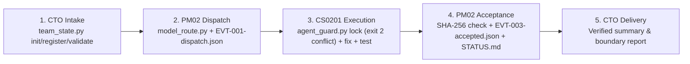

# Reproducible End-to-End Workflow Demo

This self-contained demonstration exercises the complete `CTO -> PM -> Engineer -> PM Acceptance -> CTO Delivery` lifecycle offline on Python 3.11+ using only the Python standard library. No API keys, network access, or live host subagent tools are required.

## Quickstart

Run from the repository root:

```sh
python examples/end_to_end_demo/run_demo.py
```

For machine-readable JSON output or CI verification:

```sh
python examples/end_to_end_demo/run_demo.py --verify --json
```

To inspect the generated private `registry.json`, advisory lock cleanup state, canonical task JSON, immutable atomic event files, and patched workspace copy after the run completes:

```sh
python examples/end_to_end_demo/run_demo.py --keep-temp
```

## Five-stage flow



## What is executed vs. simulated vs. host-provided

Per the repository's [evidence discipline](../../skills/cto-agent-team/references/host-adapters.md#evidence-levels), this demo explicitly separates three capability layers:

| Layer | Examples in this demo | Purpose |
| --- | --- | --- |
| **Executed locally by repo scripts** | `team_state.py` (`init`, `register`, `validate`), `model_route.py` (`demo_routing_input.json`), `agent_guard.py` (`acquire`, competing writer `exit 2`, `run` watchdog running `unittest`, `release`), atomic JSON event creation, SHA-256 verification, and `STATUS.md` generation inside a temporary directory outside the repo | Proves that local state invariants, lock conflict guards, watchdog execution, and artifact verification work deterministically |
| **Simulated for offline replay** | CTO / PM02 / CS0201 narrative handoff text, deterministic synthetic `uuid5` thread IDs (`demo-host-01`), and fixture model catalog evidence (`dispatch_ready: false`) | Makes the walkthrough reproducible without LLM credentials or real thread history |
| **Supplied by the host runtime in live use** | Creating real chats/subagents (`create_thread`, `invoke_subagent`), executing LLM reasoning, enforcing account quotas/model availability, signed-in browser inspection, and running completion heartbeats/schedules | Supplied by Codex, Google Antigravity, or another compatible host environment |

## Sample output

```text
=== codex-cto-agent-team :: Reproducible Offline End-to-End Demo ===
Task ID : TASK-DEMO-001
Outcome : accepted_and_delivered_locally

[Stage 1] CTO Intake & Private Registry
  - team_state init     : Initialized: 55 planned, 0 created, 0 ready
  - team_state validate : Valid: 53 planned, 0 created, 2 ready

[Stage 2] PM02 Task Routing & Dispatch Handoff
  - model_route state   : selected
  - selected fixture    : fixture-engineer-scoped (dispatch_ready=False)

[Stage 3] CS0201 Single-Writer Lease, Patch & Watched Test
  - acquire CS0201      : exit 0
  - competing CS0202    : exit 2 (RESOURCE_LOCKED)
  - watched unittest    : exit 0 (3 tests passed)
  - release CS0201      : exit 0

[Stage 4] PM02 Acceptance & Clerk Summary
  - SHA-256 verified    : True
  - clerk STATUS.md     : written (True)
```
